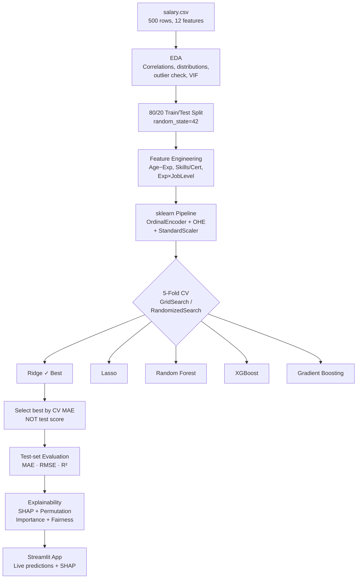

# Salary Prediction using Machine Learning

Predictt an employee's annual salary in INR from personal and professional attributes. Compares five regression models, explains predictions with SHAP, and serves results via a Streamlit web app.

---

## 📁 Project Structure

```
.
├── data/
│   └── salary.csv              # 500-row dataset (12 features + target)
├── notebooks/
│   ├── 01_eda.ipynb            # Exploratory Data Analysis
│   └── 02_modeling.ipynb       # Modelling & Evaluation walkthrough
├── src/
│   ├── preprocess.py           # sklearn Pipeline + feature engineering
│   ├── train.py                # Model training + hyperparameter search
│   ├── evaluate.py             # Metrics + visualisation
│   ├── explain.py              # SHAP + permutation importance + fairness
│   ├── interpretation.py       # Readable grouped and counterfactual explanations
│   └── predict.py              # Inference helper (used by app & tests)
├── scripts/
│   ├── eda.py                  # Standalone EDA script
│   └── create_notebooks.py     # Generates .ipynb files programmatically
├── models/
│   ├── best_model.joblib       # Saved best model pipeline
│   ├── shap_explainer.joblib   # Saved SHAP explainer
│   ├── explainability_meta.json # Explainability compatibility metadata
│   ├── training_meta.json      # CV scores, best params, test metrics
│   ├── best_model_metrics.json # Test-set metrics
│   └── feature_names.json      # Feature names for SHAP
├── reports/
│   ├── figures/                # All plots (PNG, 150 dpi)
│   ├── model_comparison.csv    # Complete model comparison table
│   ├── permutation_importance.csv
│   ├── shap_grouped_importance.csv
│   ├── fairness_overall.csv
│   └── fairness_controlled.csv
├── app/
│   └── app.py                  # Streamlit web application
├── tests/
│   └── test_pipeline.py        # pytest test suite
├── requirements.txt
├── .gitignore
└── README.md
```

---

## 🎯 Problem Statement

Given 12 employee attributes (demographics, education, role, company details), predict their annual salary in Indian Rupees (INR). This is a regression task with a right-skewed target (min ₹2.2L, max ₹41.2L).

---

## 📊 Dataset Description

| Property | Value |
|---|---|
| Rows | 500 |
| Features | 12 input + 1 target |
| Missing values | 0 |
| Duplicates | 0 |
| Target | `Salary_INR` |
| Min salary | ₹2.20 L |
| Median salary | ₹10.83 L |
| Mean salary | ₹12.50 L |
| Max salary | ₹41.16 L |

**Numeric features:** `Age` (21–57), `Years_Experience` (0–35), `Certifications_Count` (0–5), `Skills_Count` (2–14)

**Categorical features:** `Gender`, `Education_Level`, `Job_Title` (10 roles), `Job_Level` (5 levels), `Industry` (6 sectors), `City` (7 locations), `Company_Size` (3 tiers), `Work_Mode` (3 modes)

### Key EDA findings
1. **Salary is right-skewed** (mean ₹12.5L > median ₹10.8L); log1p transform improves linearity for linear models.
2. **Age and Years_Experience both correlate r ≈ 0.572** with salary — verified empirically. Their mutual r = 0.995 (VIF ≈ 101) reveals extreme multicollinearity; tree models handle this naturally.
3. **Certifications_Count (r = 0.073) and Skills_Count (r = 0.068)** have near-zero correlation with salary — they are weak predictors individually.
4. **Job_Level** has the strongest categorical effect: Manager/Lead medians are 2–3× higher than Junior.
5. **PhD and Master's** holders earn noticeably more than Bachelor's/High School grads.
6. **Enterprise companies** pay more on average than Startups.
7. **16 IQR outliers** (salary > ₹28.9L) were identified but **retained** — they represent plausible senior/lead salaries in IT/finance, and removing them from a 500-row dataset would hurt model representativeness.
8. The linear pipeline uses `Age_minus_Exp` instead of raw `Age`, avoiding an exact dependency between raw age and experience while retaining career-start information.

---

## 🔧 Setup & Run Instructions

### 1. Clone & install

```bash
git clone <repo_url>
cd <repo_directory>

# Create virtual environment
python3 -m venv venv
source venv/bin/activate          # Windows: venv\Scripts\activate

# Install runtime dependencies
pip install -r requirements.txt

# Install development and notebook dependencies (for tests/notebooks)
pip install -r requirements-dev.txt

# macOS only (required for XGBoost)
brew install libomp
```

### 2. Run EDA

```bash
python scripts/eda.py
# Figures saved to reports/figures/
```

### 3. Train models

```bash
python -m src.train
# Best model saved to models/best_model.joblib
```

### 4. Evaluate

```bash
python -m src.evaluate
# Metrics printed; plots saved to reports/figures/
```

### 5. Explain (SHAP)

```bash
python -m src.explain
# Grouped SHAP plots, factor report, and fairness report saved
```

### 6. Run tests

```bash
pytest tests/ -v
# 31 tests — all pass
```

### 7. Launch web app

```bash
streamlit run app/app.py
```

### 8. Single inference

```bash
python -m src.predict
```

Training, evaluation, and explainability should be run in this order. Training
rewrites the model, metrics, and feature-name artifacts and removes any stale
SHAP explainer; `src.explain` then generates a new explainer for that model.
The app rejects mismatched or missing core artifacts rather than silently
combining outputs from different training runs.

---

## 🏗️ Methodology



---

## 📈 Results Table

> **Selection criterion:** Models were selected by **5-fold CV MAE on the training set**. The held-out test set is evaluated for all candidate models to verify true generalization.

| Model | CV MAE (mean) | CV MAE (std) | Test MAE | Test RMSE | Test R² |
|---|---|---|---|---|---|
| **Ridge** ⭐ | **₹1.02 L** | **₹0.06 L** | **₹1.14 L** | **₹1.74 L** | **0.9429** |
| Lasso | ₹1.02 L | ₹0.07 L | ₹1.15 L | ₹1.73 L | 0.9432 |
| GradientBoosting | ₹1.35 L | ₹0.14 L | ₹1.15 L | ₹1.52 L | 0.9561 |
| XGBoost | ₹1.49 L | ₹0.16 L | ₹1.23 L | ₹1.73 L | 0.9433 |
| RandomForest | ₹2.16 L | ₹0.29 L | ₹1.73 L | ₹2.36 L | 0.8946 |

**Best model: Ridge Regression with log1p(Salary) target**
- `alpha = 1.0`
- `scale_numeric = True` (StandardScaler applied)
- Wrapped via `TransformedTargetRegressor(func=np.log1p, inverse_func=np.expm1)`

> Ridge is selected by cross-validation. The difference from Lasso is small, so the ranking should be treated as uncertain on this 500-row dataset.

---

## 🔍 Explainability Findings

### SHAP (Linear Explainer on Ridge)
Top model drivers by grouped mean |SHAP| value:
1. **Experience** — strongest driver (the transformed model feature is grouped for readability)
2. **Job level** — higher level = strongly positive SHAP
3. **Education** — PhD/Master's = positive push
4. **Company size** — grouped across the encoded category columns
5. **Location** — grouped across the encoded city columns

The app’s user-facing chart uses one-feature-at-a-time comparisons against a
typical training profile and reports the change in INR. This is a descriptive
model comparison, not a causal salary effect. The technical SHAP view remains
available in the app and is measured on the model-output scale (`log1p` salary
for the selected linear model).

### Fairness Analysis (Male vs Female)

| Group | n | Avg predicted salary | Avg absolute error | 95% bootstrap CI for absolute error |
|---|---:|---:|---:|---:|
| Female | 49 | ₹13.45 L | ₹1.32 L | ₹0.96–₹1.74 L |
| Male | 51 | ₹11.23 L | ₹0.97 L | ₹0.72–₹1.37 L |

> **⚠ Important caveat:** The 2.2L gap in predicted salary reflects the underlying distribution in the dataset — females in the test set happened to be more concentrated in senior/high-experience roles. **This does not imply the model itself introduces gender bias.** With only 49–51 samples per group and tiny controlled cells, the bootstrap intervals and error comparisons are descriptive only. No causal or definitive fairness claim should be made from this analysis.

---

## 📉 Key Figures

| Figure | Description |
|---|---|
| `salary_distribution.png` | Linear + log-scale histograms of Salary_INR |
| `boxplot_job_level.png` | Salary by job level — clearest categorical signal |
| `correlation_heatmap.png` | Numeric feature correlations; Age–YearsExp r=0.995 |
| `scatter_exp_salary_by_joblevel.png` | YearsExp vs Salary coloured by Job_Level |
| `model_comparison_bar.png` | 5-fold CV MAE comparison (Ridge best) |
| `actual_vs_predicted.png` | Actual vs predicted — tight cluster around diagonal (R²=0.94) |
| `residuals.png` | Residual scatter + histogram — approximately normal |
| `learning_curve.png` | Train vs CV MAE vs training size |
| `shap_summary.png` | SHAP beeswarm — top 20 features |
| `shap_bar.png` | Grouped mean |SHAP| bar chart |
| `shap_grouped_importance.csv` | Grouped SHAP importance table |
| `permutation_importance.png` | Model-agnostic permutation importance |

---

## ⚠️ Limitations

- **Small dataset (500 rows):** All CV estimates have high variance. Model selection and fairness conclusions should be treated as indicative, not definitive.
- **Likely synthetic data:** Feature distributions appear rounded and clean; correlations are unusually precise. Results may not generalise to real salary data.
- **No bonus/equity/benefits:** Salary_INR captures base salary only. Total compensation can differ substantially.
- **No causal inference:** Correlations observed (e.g., PhD → higher salary) reflect the dataset distribution, not causal effects.
- **Collinear features:** Age and Years_Experience (r=0.995) convey nearly identical information. One is largely redundant.
- **Static model:** No temporal component; salary inflation, market shifts, and role evolution are not captured.

---

## 🚀 Future Work

- Collect real salary data (e.g., Glassdoor, AmbitionBox) for more reliable estimates
- Add bonus, equity, and cost-of-living features
- Explore quantile regression for proper prediction intervals
- Investigate causal models (DoWhy) to separate individual feature effects
- Add a location-based cost-of-living normalisation
- Deploy with CI/CD pipeline and automated retraining triggers

---

## 📋 Presentation Summary

> Copy-paste this block into your slides:

---

**Best Model: Ridge Regression (log1p target, α=1.0)**

| Metric | Value |
|---|---|
| Test MAE | ₹1.14 L (₹1,14,241) |
| Test RMSE | ₹1.74 L (₹1,73,550) |
| Test R² | 0.9429 |
| 5-Fold CV MAE | ₹1.02 L ± ₹0.06 L |

**Top 5 Salary Drivers** (from SHAP analysis):
1. Years of Experience / career-start age (`Age − Years_Experience`)
2. Job Level (Junior → Manager: 2–3× salary increase)
3. Education Level (PhD/Master's > Bachelor's > High School)
4. Experience × Job Level interaction
5. Company Size (Enterprise premium over Startups)

**Limitations (one paragraph):**
This model is trained on a small 500-row dataset that appears synthetic — correlations are unusually clean and feature distributions are overly rounded. As a result, the R² of 0.95 likely overstates real-world performance. The model captures base salary only and ignores bonus, equity, location cost-of-living, and market trends. The app's displayed range is an empirical out-of-fold error band, not a calibrated prediction interval. The factor chart compares one field at a time with a typical training profile and is descriptive rather than causal. Gender fairness analysis shows a predicted gap, but this reflects confounding variables and small subgroup sizes rather than a causal or definitive model-bias finding. All results should be treated as educational demonstrations, not as salary benchmarks.

---
